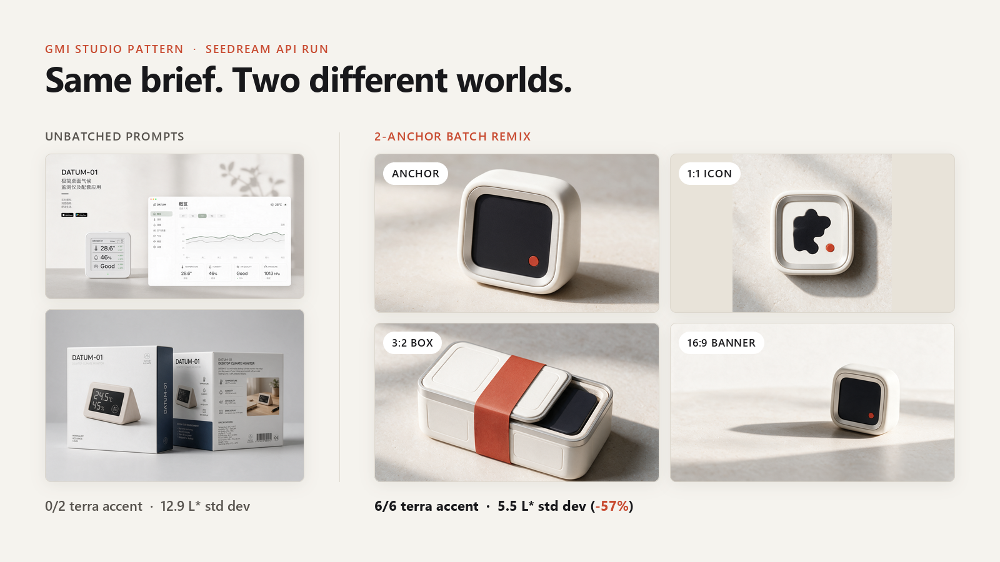

# Reusable Brand & UI Asset Factory in GMI Studio

A standalone public workflow template and offline verification repository showing how to structure a two-phase, multi-format brand and UI asset factory patterned after **GMI Studio** (`LLM Node`, `Reve Create`, `GMI Image Upload`, `GMI Batch Images`, `Reve Remix`), paired with a live **Seedream 5.0 Pro** multi-reference API run and an offline **CIELAB** color/consistency verifier.

**GMI-hosted models only, not the whole market.** This repository does not compare GMI Cloud prices or quality against any other provider.



## Why build an asset factory instead of single prompts

When you prompt an image model one asset at a time with a short brand description, separate calls drift in lighting, product silhouette, palette, and invented copy. On our fictional desktop climate monitor fixture (`DATUM-01`), two unbatched `seedream-5.0-pro` prompts from the raw brief produced:

- `assets/baseline/baseline_dashboard.png` (`2720x1536`, 16:9): a bright white-and-gray product mockup showing a square desktop monitor beside a companion chart UI (`L* = 90.51`) with zero terracotta brand accent.
- `assets/baseline/baseline_packaging.png` (`2496x1664`, 3:2): a darker cool-gray and navy box (`L* = 72.22`) showing a wedge-shaped desktop climate monitor displaying temperature and humidity, fine-print spec text, and an invented "DATUM ELEVATE" mark.

To keep assets aligned across formats, this repository packages a two-phase multi-reference factory pattern modeled on GMI Studio's documented batch workflow:

1. **LLM expansion (`zai-org/GLM-5.3-Flash`, `temperature = 0.0`)** expands one structured `brand_brief.json` into six slot-specific prompts carrying locked hex swatches, materials, camera-left morning daylight, and negative constraints.
2. **Stage 1 (Anchors)** generates two visual style anchors (`anchor_hardware` and `anchor_interface`) for a human approval gate.
3. **Reference batching (`GMI Image Upload` x2 -> `GMI Batch Images` in Studio, or `parameters.image = [anchor_1, anchor_2]` in the API)** packs both approved anchors into one shared reference list.
4. **Stage 2 (4x Multi-Reference Remix)** feeds that shared reference list into four outputs across three aspect ratios (`1:1` App Icon, `16:9` Companion Dashboard, `3:2` Retail Packaging, `16:9` Launch Header).

## Two shipped GMI Studio workflow templates

Both JSON files below are **GMI Studio workflow templates** modeled on GMI Studio's documented batch pattern (neither JSON was executed live inside the Studio web editor; the 6 measured images in `assets/factory/` were produced via GMI's live `seedream-5.0-pro` API using the same two-phase, two-anchor multi-reference pattern).

| Workflow template | Image nodes | Role in this repository |
|---|---|---|
| `workflows/brand-asset-factory.studio.json` | `Reve Create` (`reve-create-20250915`) + `Reve Remix` (`reve-remix-20250915`) | Studio workflow template following the documented `LLM Node`, `Reve Create`, `GMI Image Upload`, `GMI Batch Images`, `Reve Remix`, and `Save Image` topology. |
| `workflows/brand-asset-factory-seedream.studio.json` | `Seedream 5.0 Pro` placeholder nodes (`seedream-5.0-pro`, up to 14 reference images) | API-parity template matching the model used in the live `2026-11-25` run, because `reve-create-20250915` and `reve-remix-20250915` reported `available: false` in the multimodal API (and `reve-2-1` returned HTTP 503 `upstream_unavailable`). |

Both templates have **16 nodes, 12 links, and 0 dangling links**, validated automatically by `factory_core.py`.

### Notes before importing into the GMI Studio canvas

- **Two-phase manual handoff:** Run Stage 1 first, inspect the two saved anchors (`anchor_hardware`, `anchor_interface`), upload them into the two `GMI Image Upload` nodes, and then run Stage 2.
- **LLM output transfer:** GMI Studio's documented node set does not include a JSON-slice node, so the `LLM Node` has no outgoing link in either JSON template. Per-slot prompts in the template widgets are authored separately from the live API expansion saved in `outputs/expanded_prompts.json` (`python run_factory.py --expand`).
- **Studio editor pin/class checks:** GMI Studio's node reference pages list `Reve Create` / `Reve Remix` outputs as `VIDEO`, and Seedream node class titles in the Seedream template are placeholders. Confirm node classes and `IMAGE` pin wiring in the Studio editor before running a paid job.
- **Reusing for another brand:** Adapting this repository to a new brand requires updating `brand_brief.json`, relaxing or updating the `DATUM-01` fixture checks in `factory_core.py` (`validate_brief`), updating the template prompt widgets, and uploading two new approved Stage 1 anchors.

## Live verified results (2026-11-25, Seedream 5.0 Pro API run)

All 6 factory assets in `assets/factory/` were generated live via GMI's `seedream-5.0-pro` API using the LLM-expanded prompts in `outputs/expanded_prompts.json` (`zai-org/GLM-5.3-Flash`, `1,069` prompt tokens, `968` completion tokens, `51.7 s`). All 4 Stage 2 remixes received both Stage 1 anchor PNG URLs together in `parameters.image` (mirroring `GMI Batch Images -> Remix`). Total list price for the 6 factory images was **`$0.51`** (`6 x $0.085`).

Measured offline by `python run_factory.py --verify-manifest outputs/asset_manifest.json` (`outputs/factory_results.json`, 160 px `BILINEAR` CIELAB D65 sample):

| Group / Slot | Aspect | Size | Aspect OK | Mean $\Delta E_{76}$ | Palette adherence ($\le 18$) | Chroma outliers | Terra accent (`#C84B31`) | Mean $L^*$ |
|---|---|---|---:|---:|---:|---:|---:|---:|
| `baseline_dashboard` | `16:9` | `2720x1536` | Yes (`0.39%`) | `4.41` | `99.22%` | `0.00%` | **No** (`0.00%`) | `90.51` |
| `baseline_packaging` | `3:2` | `2496x1664` | Yes (`0.00%`) | `11.30` | `84.71%` | `0.00%` | **No** (`0.00%`) | `72.22` |
| **Baseline summary (`n=2`)** | — | — | **2 / 2** | **`7.85`** | **`91.97%`** | **`0.00%`** | **0 / 2** | **`81.37` ($\sigma = 12.94$)** |
| `anchor_hardware` | `16:9` | `2720x1536` | Yes (`0.39%`) | `8.12` | `86.58%` | `0.02%` | **Yes** (`0.15%`) | `71.97` |
| `anchor_interface` | `16:9` | `2720x1536` | Yes (`0.39%`) | `7.09` | `87.24%` | `0.02%` | **Yes** (`0.01%`) | `82.77` |
| `asset_app_icon` | `1:1` | `2048x2048` | Yes (`0.00%`) | `7.24` | `84.81%` | `0.02%` | **Yes** (`0.19%`) | `78.17` |
| `asset_dashboard_shell` | `16:9` | `2720x1536` | Yes (`0.39%`) | `11.55` | `70.06%` | `0.01%` | **Yes** (`0.01%`) | `74.37` |
| `asset_packaging` | `3:2` | `2496x1664` | Yes (`0.00%`) | `10.52` | `80.29%` | `0.97%` | **Yes** (`6.35%`) | `72.20` |
| `asset_social_banner` | `16:9` | `2720x1536` | Yes (`0.39%`) | `4.44` | `94.83%` | `0.02%` | **Yes** (`0.03%`) | `84.90` |
| **Factory summary (`n=6`)** | — | — | **6 / 6** | **`8.16`** | **`83.97%`** | **`0.18%`** | **6 / 6** | **`77.40` ($\sigma = 5.50$)** |

### Key observations and measurement limits

1. **57.5% lower lightness standard deviation:** The sample standard deviation (`n - 1`) of per-image mean `L*` fell from **`12.94 L*`** across the 2 unbatched baseline images (min-max range `18.30 L*`) to **`5.50 L*`** across all 6 factory images (min-max range `12.93 L*`).
2. **Terracotta accent presence (`6/6` vs `0/2`):** Every factory asset contained pixels within the terracotta detector threshold ($C^* > 25$ and $\Delta E_{76} \le 25$ from `#C84B31`, appearing as a status dot on the device/icon/UI/banner and a terracotta paper band on `asset_packaging`), compared to `0/2` on the unbatched baselines. Note that `has_terra_accent` is a presence detector (`>= 1` sampled pixel), not an exact swatch or silhouette proof, and aspect ratio checks passed on both groups (`6/6` factory vs `2/2` baseline).
3. **Metric tradeoffs (what flat $\Delta E_{76}$ missed on a neutral palette):** On this run, mean $\Delta E_{76}$ was slightly higher for the factory (`8.16` vs `7.85`), palette adherence was lower (`83.97%` vs `91.97%`), and chroma outliers were slightly higher (`0.18%` vs `0.00%`, driven mainly by shaded terracotta pixels on the packaging band). Visually, `baseline_dashboard` was a flat white-and-gray mockup whose pixels happen to sit near `#F5F3EE` and `#D8D4CC` in Lab space while omitting the terracotta accent and differing sharply from `baseline_packaging`. Flat pixel-to-palette $\Delta E_{76}$ alone is not a sufficient brand-consistency check on neutral palettes.
4. **Layout similarity on `asset_dashboard_shell`:** In visual inspection, `asset_dashboard_shell` closely repeated the modular tile layout of `anchor_interface`. We did not run an ablation on reference count or prompt wording; testing single-anchor conditioning or stronger composition directives is a practical next step if you want wider layout divergence.

## Quick start

The core verifier (`factory_core.py`, `run_factory.py`, `test_factory.py`) requires Python 3.10+ and `Pillow` (`pip install -r requirements.txt`). Offline tests, `--dry-run`, and `--verify-manifest` make **zero API calls**.

### 1. Run offline unit tests (28 tests, zero API spend)

```bash
python -m unittest test_factory.py -v
```

### 2. Run the offline dry run (template validation + synthetic CIELAB fixtures)

```bash
python run_factory.py --dry-run
```

### 3. Reproduce the CIELAB verification on the shipped live assets (zero API spend)

```bash
python run_factory.py --verify-manifest outputs/asset_manifest.json
```

### 4. Expand `brand_brief.json` live via GMI Inference (1 paid LLM call)

```bash
export GMI_API_KEY="your-gmi-api-key"
python run_factory.py --expand
```

### 5. Re-render the comparison card or 60-second video locally

The rendering scripts under `scripts/` additionally require `numpy`, Windows system fonts (`Segoe UI` and `Consolas` in `C:\Windows\Fonts\`), and `ffmpeg` on `PATH` (plus local raw Veo/audio clips under gitignored `video/raw/` for `render_video.py`). The finished `factory-card.png` and `video/studio-asset-factory-60s.mp4` are already tracked in this repo.

```bash
python scripts/render_card.py
python scripts/render_video.py
```

## Repository layout

```text
brand_brief.json                                 Locked DATUM-01 brand fixture (neutral example)
factory_core.py                                  CIELAB D65 math, brand-fit checks, workflow template validator
run_factory.py                                   CLI: --dry-run, --expand, --verify-manifest
test_factory.py                                  28 offline unit tests
workflows/
  brand-asset-factory.studio.json                GMI Studio workflow template (LLM Node + Reve Create + Batch + Remix)
  brand-asset-factory-seedream.studio.json       Seedream 5.0 Pro API-parity Studio template
assets/
  baseline/                                      2 unbatched baseline PNGs
  factory/                                       2 Stage 1 anchors + 4 Stage 2 two-anchor remixes
outputs/
  expanded_prompts.json                          Live GLM-5.3-Flash 6-slot expansion
  asset_manifest.json                            Manifest mapping all 8 baseline + factory PNGs
  factory_results.json                           Verified CIELAB comparison report
scripts/
  kit.py                                         Shared warm-alabaster editorial rendering primitives
  render_card.py                                 Renders factory-card.png (1600x900)
  render_video.py                                Renders video/studio-asset-factory-60s.mp4 (1920x1080, 30fps)
factory-card.png                                 Side-by-side baseline vs 2-anchor batch visual summary
video/studio-asset-factory-60s.mp4               60-second launch video
cost-log.md                                      Full itemized media/LLM costs and account credit deltas
LICENSE                                          MIT
```

## License

MIT. See `LICENSE`.
